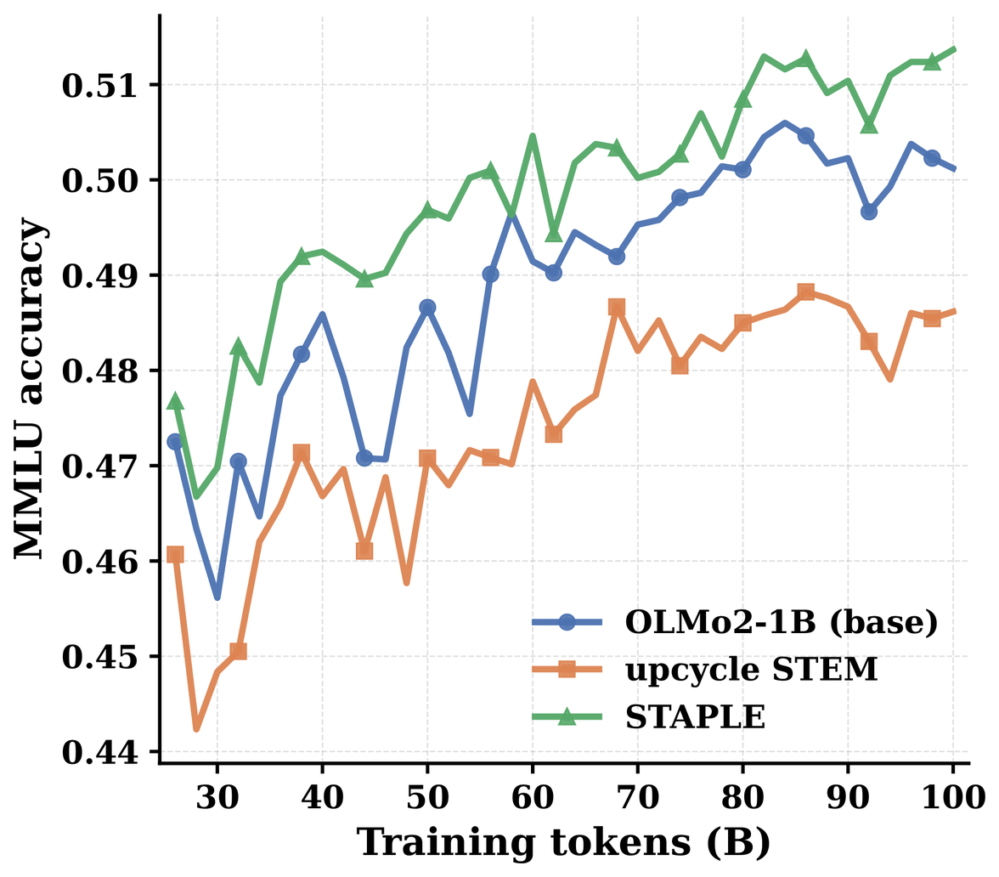
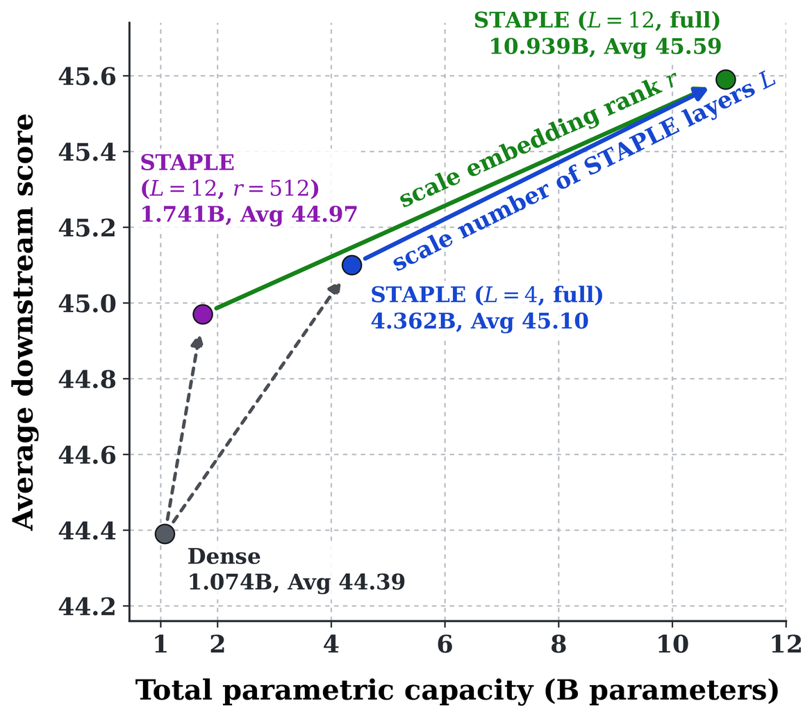
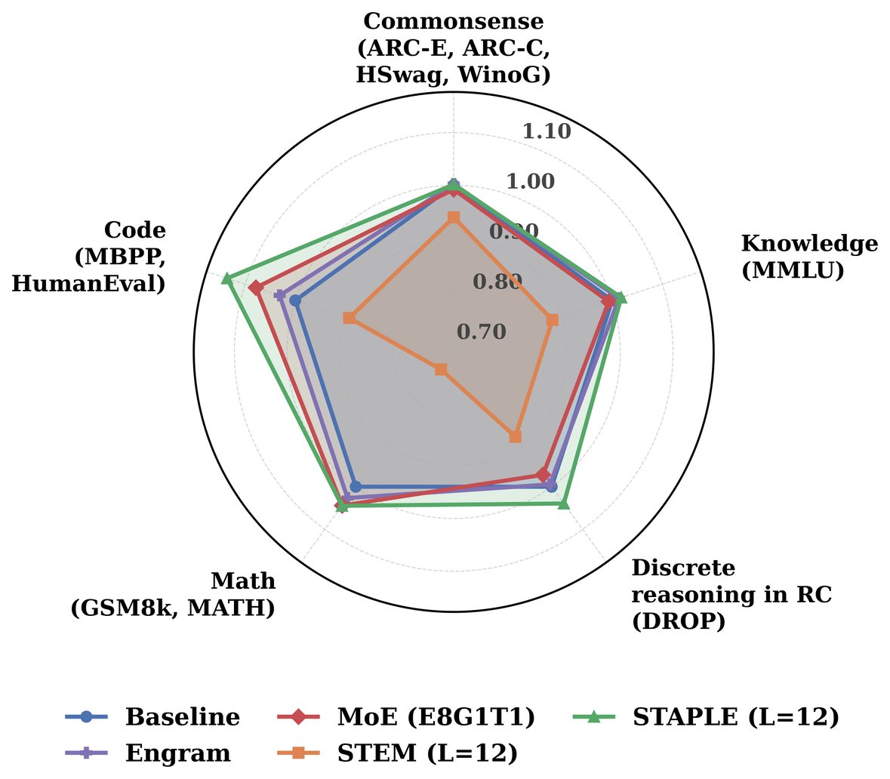

<div align="center">

# STAPLE: Static Sparse Upcycling of Pretrained Checkpoints via Embedding Modules

Ranajoy Sadhukhan<sup>1</sup>, Euijin Hong<sup>1</sup>, Sheng Cao<sup>2</sup>,
Zechun Liu<sup>3</sup>, Shuowei Jin<sup>4</sup>, Sha Li<sup>4</sup>,
Changlong Yu<sup>4</sup>, Xin Liu<sup>4</sup>, Qin Lu<sup>4</sup>,
Zhenyu Shi<sup>4</sup>, Priyanka Nigam<sup>4</sup>, Beidi Chen<sup>1</sup>

<sup>1</sup>Carnegie Mellon University &nbsp;·&nbsp;
<sup>2</sup>D. E. Shaw Research &nbsp;·&nbsp;
<sup>3</sup>Meta AI &nbsp;·&nbsp;
<sup>4</sup>Amazon Research

<!-- TODO: link the Hugging Face models once they are public. -->
[**Paper (arXiv)**](https://arxiv.org/abs/2610.12599) &nbsp;·&nbsp;
[**Website**](https://infini-ai-lab.github.io/STAPLE) &nbsp;·&nbsp;
**Hugging Face** *(coming soon)*

</div>

STAPLE enhances a pretrained model with **static sparse memory**: each augmented FFN layer
gets a token-indexed embedding table that complements its up-projection with
input-specific knowledge, scaling capacity without degrading the throughput or memory
efficiency of the seed model.

This repository contains the code to train and evaluate STAPLE and the baselines it is
compared against in the paper (continued dense training of OLMo-2, an Engram-style
static-memory model and MoE upcycling), from checkpoint conversion through warmup,
mid-training and the ten-task evaluation. It is built on
[torchtitan](https://github.com/pytorch/torchtitan), PyTorch's native library for
large-scale LLM training.

<p align="center">
  
  
  
</p>

**Figure 1.** **(a)** STAPLE improves over the dense baseline early in mid-training, while
replacement-style STEM upcycling remains below it. The horizontal axis counts
mid-training tokens, excluding the preceding warmup or dense continuation stage.
**(b)** Downstream performance improves as static sparse capacity is increased through
embedding rank or the number of augmented layers. **(c)** Domain averages normalized to
continued dense training; the largest gain is in code, with smaller gains in mathematics,
knowledge, and reading comprehension.

## Quick start

The steps below train and evaluate STAPLE-12L on OLMo-2 1B on a single node with 8 GPUs.
Run every command from the repository root.

**1. Install.** Install a recent PyTorch nightly (tested with `2.13.0.dev20260603+cu130`),
then:

```bash
git clone https://github.com/Infini-AI-Lab/STAPLE.git && cd STAPLE
pip install -r requirements.txt
```

**2. Get the seed checkpoint.** The paper upcycles the OLMo-2 1B stage-1 checkpoint at 4T
tokens. Download it and convert it to torchtitan's DCP format:

```bash
hf download allenai/OLMo-2-0425-1B --revision stage1-step1907359-tokens4001B --local-dir ./olmo2-1b-hf
python -m scripts.checkpoint_conversion.convert_from_hf ./olmo2-1b-hf ./olmo2-1b-dcp \
    --model_name olmo2 --model_flavor 1B
```

The Hugging Face weights carry no optimizer state. The paper additionally starts the
backbone's AdamW state from the released pretrained state, which
`scripts/checkpoint_conversion/convert_baseline_to_torchtitan.py --include-optimizer`
converts from a consolidated OLMo-2 checkpoint.

**3. Prepare data.** Training reads pre-shuffled JSONL chunks, one directory per source,
with one document per line under a `"text"` key:

```
<data-root>/<source>/<source>.chunk.00.jsonl
```

Warmup uses a single source, `dclm-baseline_shuffled` (DCLM Baseline 1.0). Mid-training
uses the Dolma 3 Dolmino Mix, split into the 22 sources (directory names and weights)
listed in `_STEM_SOURCES` in `torchtitan/experiments/stem_dag/config_registry.py`.

**4. Warmup, then mid-training.** Each stage runs 50,000 steps of 512 × 4,096 tokens.
Mid-training resumes from the final warmup checkpoint, including its optimizer state:

```bash
# Warmup: STAPLE tables train with the pretrained up-projections frozen
NGPU=8 MODULE=stem_dag CONFIG=stem_dag_1b_prefine ./run_train.sh \
    --hf-assets-path ./olmo2-1b-hf --dataloader.root-dir <warmup-data-root> \
    --checkpoint.enable --checkpoint.initial-load-path ./olmo2-1b-dcp \
    --checkpoint.no-last-save-model-only --dump-folder ./outputs/staple_1b_warmup

# Mid-training
NGPU=8 MODULE=stem_dag CONFIG=stem_dag_1b_midfine ./run_train.sh \
    --hf-assets-path ./olmo2-1b-hf --dataloader.root-dir <midtraining-data-root> \
    --checkpoint.enable \
    --checkpoint.initial-load-path ./outputs/staple_1b_warmup/checkpoint/step-50000 \
    --checkpoint.no-initial-load-model-only \
    --checkpoint.exclude-from-loading dataloader,lr_scheduler,train_state \
    --dump-folder ./outputs/staple_1b_midfine
```

The other models in the paper use the same two commands with a different module and
config:

| Model | `MODULE` | Warmup `CONFIG` | Mid-training `CONFIG` |
|---|---|---|---|
| Dense baseline | `olmo2` | `olmo2_1b_prefine` | `olmo2_1b_midfine` |
| STAPLE (`L`=4) | `stem_dag` | `stem_dag_1b_l4_prefine` | `stem_dag_1b_l4_midfine` |
| STAPLE (`L`=12) | `stem_dag` | `stem_dag_1b_prefine` | `stem_dag_1b_midfine` |
| STAPLE (`L`=12, `r`=512) | `stem_dag` | `stem_dag_lowrank_1b_r512_prefine` | `stem_dag_lowrank_1b_r512_midfine` |
| Engram-style | `engram_olmo2` | `engram_olmo2_1b_stem_dag_l12_prefine` | `engram_olmo2_1b_stem_dag_l12_midfine` |
| MoE upcycling (8 experts, top-1) | `olmo2_moe` | `olmo2_moe_1b_e8g1t1_8l_warmup` | `olmo2_moe_1b_e8g1t1_8l_midfine` |

The MoE warmup starts from an upcycled copy of the seed instead of `./olmo2-1b-dcp`:

```bash
python -m scripts.checkpoint_conversion.upcycle_olmo2_to_moe ./olmo2-1b-dcp ./olmo2-1b-e8g1t1-8l-dcp
```

OLMo-2 7B configs (`olmo2_7b_*`, `stem_dag_7b_*`) and multi-node launchers for every run
are in `torchtitan/models/olmo2/`, `torchtitan/experiments/stem_dag/` and `scripts_gl/`.

**5. Evaluate** on the paper's ten tasks with
[lm-eval](https://github.com/EleutherAI/lm-evaluation-harness), using the config the
checkpoint was trained with:

```bash
pip install -r scripts/eval/requirements.txt
torchrun --nproc_per_node=8 scripts/eval/eval_harness.py \
    --module stem_dag --config stem_dag_1b_midfine \
    --checkpoint ./outputs/staple_1b_midfine/checkpoint/step-50000 --tokenizer_path ./olmo2-1b-hf \
    --tasks_config scripts/eval/configs/olmo_evals.yaml --dataset_root <eval-data-root> \
    --confirm_run_unsafe_code --output_path results/staple_1b.json
```

[`docs/evaluation.md`](docs/evaluation.md) lists the ten tasks and the `--config` to use
for every model.

## Results

**Upcycling comparison** (Table 1 of the paper). All 1B models start from the same OLMo-2
1B seed and train on 100B warmup + 100B mid-training tokens; the Engram-style baseline's
added embedding memory is parameter-matched to STAPLE-12L, and the replacement-style STEM
and additive STAPLE models both use 12 embedding layers. The 7B block uses STAPLE with
`L`=16 and about 30B warmup + 70B mid-training tokens. Best values are in bold within
each backbone block.

| Method | ARC-E | ARC-C | HSwag | WinoG | MMLU | DROP | GSM8K | MATH | MBPP | HEval | **Avg.** |
|---|---|---|---|---|---|---|---|---|---|---|---|
| ***OLMo-2 1B*** | | | | | | | | | | | |
| Baseline | 75.42 | **47.44** | 65.18 | **66.22** | 50.30 | 41.91 | 37.76 | 7.68 | 28.80 | 23.17 | 44.39 |
| MoE upcycling (8 experts, top-1) | 75.04 | 45.73 | 66.82 | 64.72 | 49.96 | 40.74 | 39.80 | 7.64 | 28.00 | **28.05** | 44.65 |
| Engram-style | **77.40** | 47.35 | 66.05 | 64.01 | 50.98 | 41.68 | 38.21 | **8.44** | 29.20 | 24.39 | 44.77 |
| STEM (`L`=12) | 74.37 | 42.06 | 60.79 | 61.56 | 44.30 | 37.00 | 26.00 | 6.94 | 22.60 | 23.78 | 39.94 |
| STAPLE (`L`=12) | 76.60 | 45.99 | **68.27** | 63.77 | **51.21** | **43.56** | **40.03** | 7.44 | **31.60** | 27.44 | **45.59** |
| ***OLMo-2 7B*** | | | | | | | | | | | |
| Baseline | 82.07 | 55.97 | 77.52 | **74.82** | 62.53 | 62.79 | 67.79 | 11.08 | 41.80 | 34.76 | 57.11 |
| STAPLE (`L`=16) | **82.58** | **57.76** | **77.62** | 74.35 | **62.67** | **63.55** | **70.13** | **12.02** | **43.40** | **35.98** | **58.01** |

**STAPLE scalability on OLMo-2 1B** (Table 2 of the paper). Increasing the number of
augmented layers `L` and the embedding dimension `r` are separate capacity axes;
`r`=512 denotes the low-rank variant, while the other STAPLE rows use full-width
embeddings. All rows use the same continued-training budget (100B warmup + 100B
mid-training tokens). Best values are in bold.

| Method | ARC-E | ARC-C | HSwag | WinoG | MMLU | DROP | GSM8K | MATH | MBPP | HEval | **Avg.** |
|---|---|---|---|---|---|---|---|---|---|---|---|
| Baseline | 75.42 | **47.44** | 65.18 | **66.22** | 50.30 | 41.91 | 37.76 | **7.68** | 28.80 | 23.17 | 44.39 |
| STAPLE (`L`=4) | **76.98** | 46.25 | 66.00 | 65.82 | **51.27** | 42.83 | 39.35 | 7.08 | 29.80 | 25.61 | 45.10 |
| STAPLE (`L`=12) | 76.60 | 45.99 | **68.27** | 63.77 | 51.21 | **43.56** | **40.03** | 7.44 | **31.60** | **27.44** | **45.59** |
| STAPLE (`L`=12, `r`=512) | 76.18 | 46.67 | 66.99 | 65.59 | 50.49 | 41.91 | 39.80 | 6.28 | 30.20 | 25.61 | 44.97 |

<sub>ARC-E, WinoGrande, MMLU: 0-shot accuracy. ARC-C, HellaSwag: 0-shot normalized
accuracy. DROP: 3-shot F1. GSM8K: 5-shot strict exact match. MATH: 0-shot exact match.
MBPP: 5-shot pass@1. HumanEval: 0-shot pass@1.</sub>

## Citation

```bibtex
@misc{sadhukhan2026staplestaticsparseupcycling,
      title={STAPLE: Static Sparse Upcycling of Pretrained Checkpoints via Embedding Modules},
      author={Ranajoy Sadhukhan and Euijin Hong and Sheng Cao and Zechun Liu and Shuowei Jin and Sha Li and Changlong Yu and Xin Liu and Qin Lu and Zhenyu Shi and Priyanka Nigam and Beidi Chen},
      year={2026},
      eprint={2610.12599},
      archivePrefix={arXiv},
      primaryClass={cs.LG},
      url={https://arxiv.org/abs/2610.12599},
}
```

## License

STAPLE is released under the BSD 3-Clause license (see [`LICENSE`](LICENSE)), the same
license as [torchtitan](https://github.com/pytorch/torchtitan), whose copyright notice is
retained in `LICENSE` and in the file headers.
